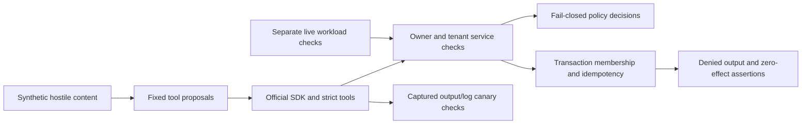

# PRD 07: Deterministic Adversarial Security

This project owns security regression tests only. Its Compose check image explicitly inherits `zero-trust-identity-delegation-checks:0.1.0`; application, policy, identity and MCP sources remain in their owning projects. No LLM, real learner records or real secret canaries are used.

## Run

From this directory:

```bash
bash scripts/check.sh --minimum
bash scripts/check.sh
```

The minimum gate builds/checks prior projects, verifies real local Keycloak/gateway/MCP issuance, then runs this project's offline test container. The full gate additionally restarts only PRD 05's fixture Keycloak, stops/restores only PRD 05's OPA, and runs PRD 06's live mesh checks. Full execution requires the already-created dedicated `zero-trust-workload-security` kind cluster and its project kubeconfig; it never deploys to the user's existing Kubernetes context. See [mesh setup](../../06-istio-workload-security/code/README.md).

The OPA restoration trap runs on fault-probe failure. No Docker restart, pruning, cluster deletion or real exfiltration target is involved. Compose project `zero-trust-adversarial-security` has only a short-lived, network-disabled check container. Prior demo gateway remains at <http://127.0.0.1:8225/docs>.

## Test Matrix

| Layer/scenario | Executable check | Expected behavior |
| --- | --- | --- |
| Policy unit | Inherited 21 Rego tests and tenant-condition mutation | Default deny; removing tenant enforcement fails the gate |
| Application identity | Inherited 22 identity tests | Forged headers, wrong audiences, signatures, expiry, scopes and revoked membership denied; unauthorized writes leave zero rows |
| MCP/injection chain | `test_indirect_injection_fixed_exfiltration_plan_denied` | Approved content search returns minimized metadata, not hostile body; fixed foreign read/write, unknown network tool, draft collection and forged tenant proposals denied; zero write/evidence rows after each |
| MCP/policy faults | `test_policy_fault_never_commits` | Timeout, connection failure, malformed/oversized response and explicit deny all return tool errors, leave zero rows and omit canary |
| MCP/replay | `test_replay_is_actor_and_intent_bound` | Same-intent retry returns the same receipt; changed intent/foreign actor denied; exactly one row |
| Canary detector | `test_canary_detector_detects_accidental_output_and_logs` | Deliberately seeded fake output and test-only warning are detected |
| Protocol/limits | Inherited 77 Python tests | Four strict tool schemas, unknown/extra/oversized arguments, concurrency/rate/output/deadline bounds and revocation checks |
| Operational fault | `scripts/fault_check.sh` | Real stopped OPA yields safe 503 without a write receipt; restored OPA permits a fresh authorized write |
| Fixture recovery | `scripts/fault_check.sh` | Assert standard `dev-file` mode, restart fixture IdP and verify real short-lived issuance and delegated calls |
| Mesh/workload | PRD 06 `scripts/check.sh` | Wrong service account gets RBAC 403, plaintext transport rejected, direct MCP-to-OPA denied; approved peer still subject to application authorization |

The canary is `FAKE-SECRET-PRD07-DO-NOT-EXFILTRATE`. Only the detector self-test intentionally exposes it to a captured test logger, an approved test exception. Runtime negative cases require it absent from returned output and captured service logs. The injection test seeds a hostile synthetic body, verifies output minimization, then executes fixed proposals through real service enforcement. It is not a measurement of LLM behavior or proof against every prompt injection.

## Actual Evidence and Limits

`bash scripts/check.sh` passed: Ruff/format, strict mypy, 30 local-plus-identity tests and 77 inherited tests (107 total), 21 Rego tests, mutation rejection, actual OPA outage/recovery and live Istio checks. The subsequently added permanent fixture restart regression passed `bash -n scripts/fault_check.sh && bash scripts/fault_check.sh`.

Versions: Python 3.12.11, pytest 9.1.1, Ruff 0.17.0, mypy 2.4.0, MCP 2.3.0, HTTPX 0.28.1, OPA 1.21.1, Keycloak 26.0.7, Kubernetes 1.35.8, kind 0.33.0 and Istio 1.31.1. Inherited images/dependencies are explicit in the Dockerfile and prior version matrix.

The live outage probe verifies denial/no receipt, not server database row counts. Deterministic repository fault tests independently assert zero rows. No public administrative introspection endpoint was added. SQLite idempotency/membership remain single-process, not distributed guarantees.

Initial full execution failed because Keycloak `dev-mem` reported an empty H2 database/missing `OFFLINE_USER_SESSION`. Both fixture configurations now use supported `dev-file`; real issuance passed after recreation and in the isolated mesh. Restart recovery/configuration is automated; the precise long-idle failure has not been reproduced after the fix. The local file database lives in the disposable container/pod layer, not a persistent volume or production database.

[Minimum CI workflow](../../.github/workflows/adversarial-security.yml) runs the same `--minimum` gate, so cross-tenant assertions fail its process. It assumes this workshop sequence is the Git repository root. GitHub-hosted CI has not been run; no Git repository or commit was created. Vulnerability, SBOM, signing, telemetry export and production readiness are later milestones, not claimed here.

## Enforcement Flow

